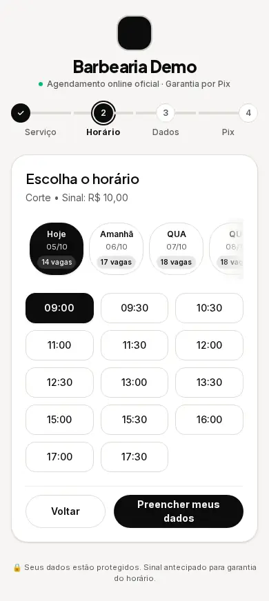
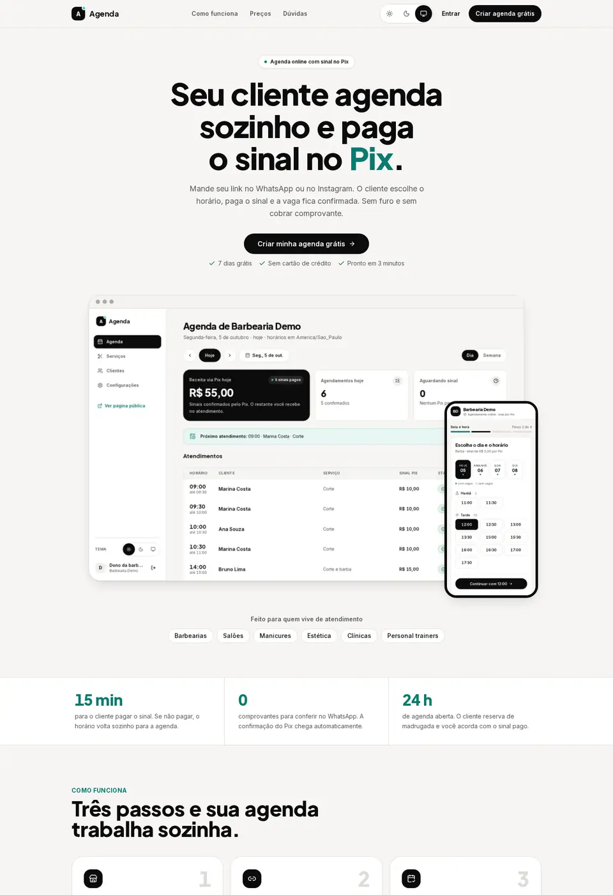
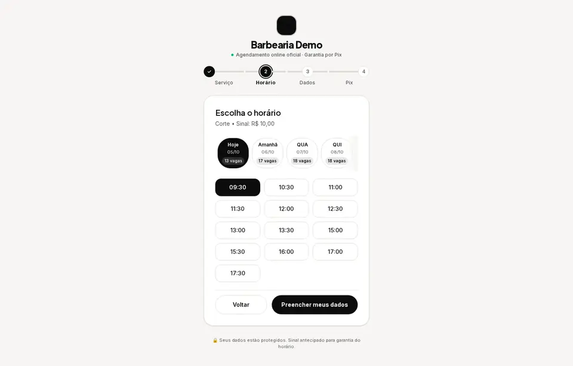
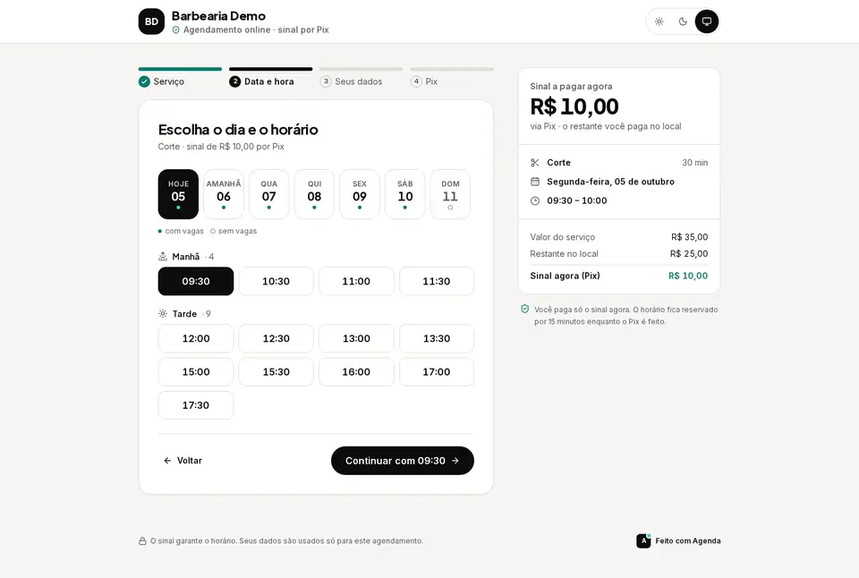
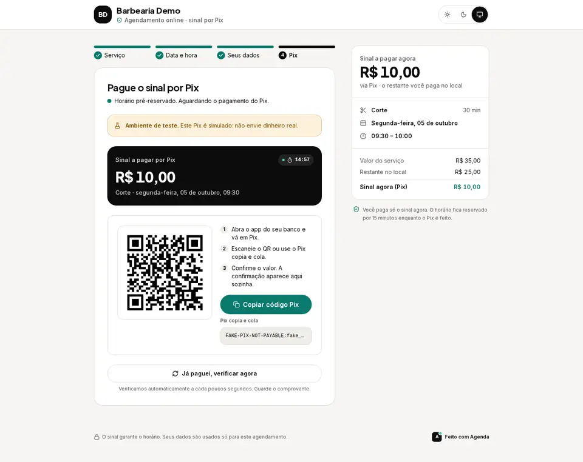
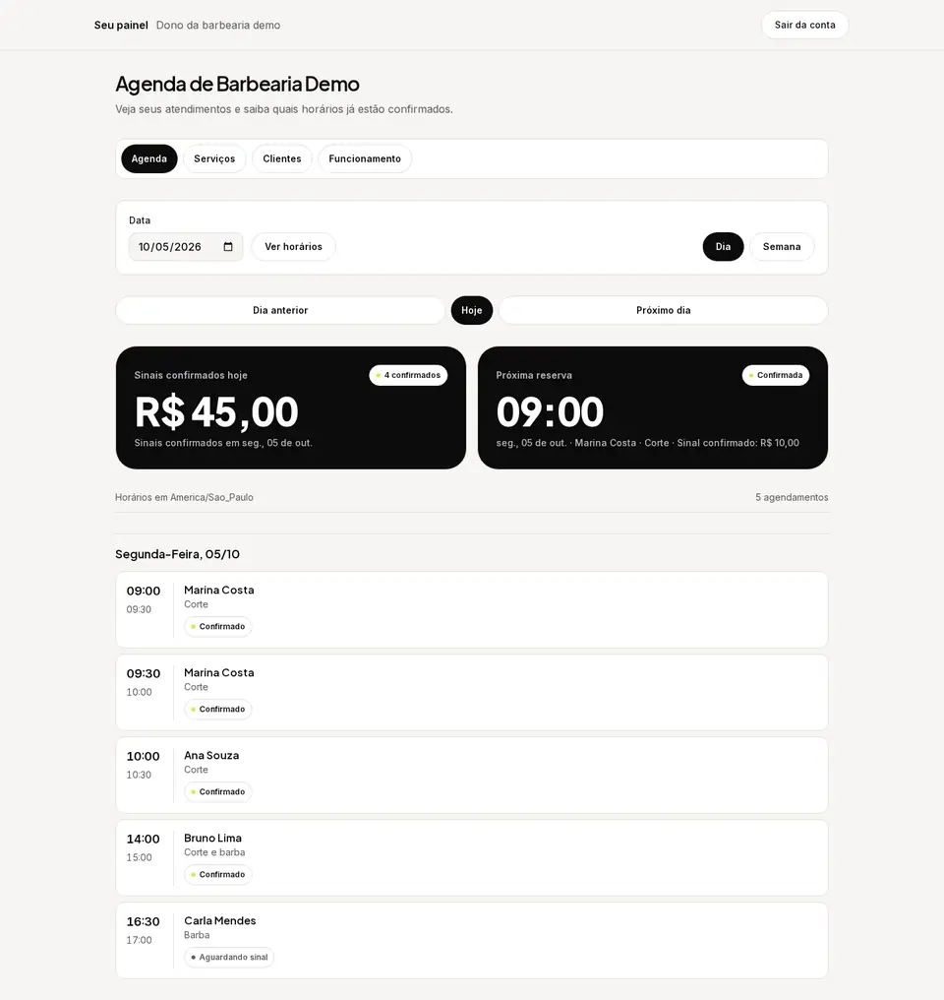
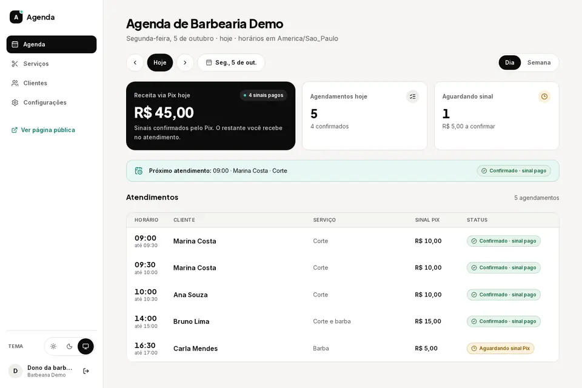
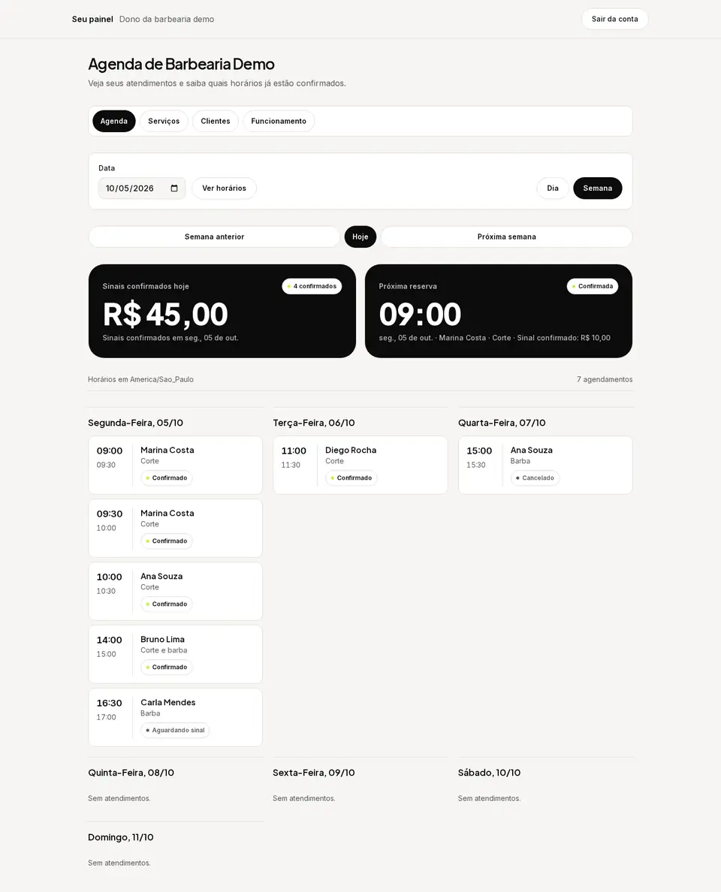
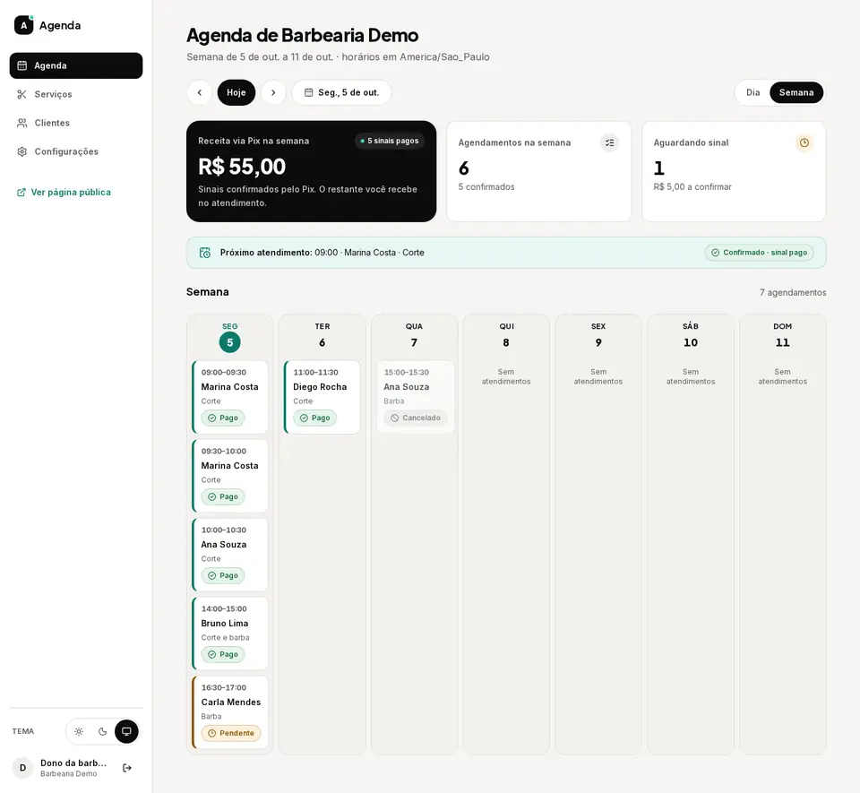

# Redesign: antes e depois

Capturas do mesmo fluxo com os mesmos dados de demonstração, antes (branch `feat/backend`) e depois do redesign. Celular em 390 px e desktop em 1440 px (reduzido para 960 px). Páginas longas foram cortadas no topo.

## Celular (390 px)

| Tela | Antes | Depois |
| --- | --- | --- |
| Landing |  |  |
| Página pública: dia e horário |  |  |
| Página pública: Pix |  |  |
| Painel: agenda do dia |  |  |
| Painel: semana |  |  |

## Desktop (1440 px)

| Tela | Antes | Depois |
| --- | --- | --- |
| Landing |  |  |
| Página pública: dia e horário |  |  |
| Página pública: Pix |  |  |
| Painel: agenda do dia |  |  |
| Painel: semana |  |  |

As 24 telas de cada viewport (antes e depois) foram geradas pelo mesmo roteiro de captura e acompanham o relatório do PR; aqui ficam só os pares mais representativos para não pesar o repositório.
